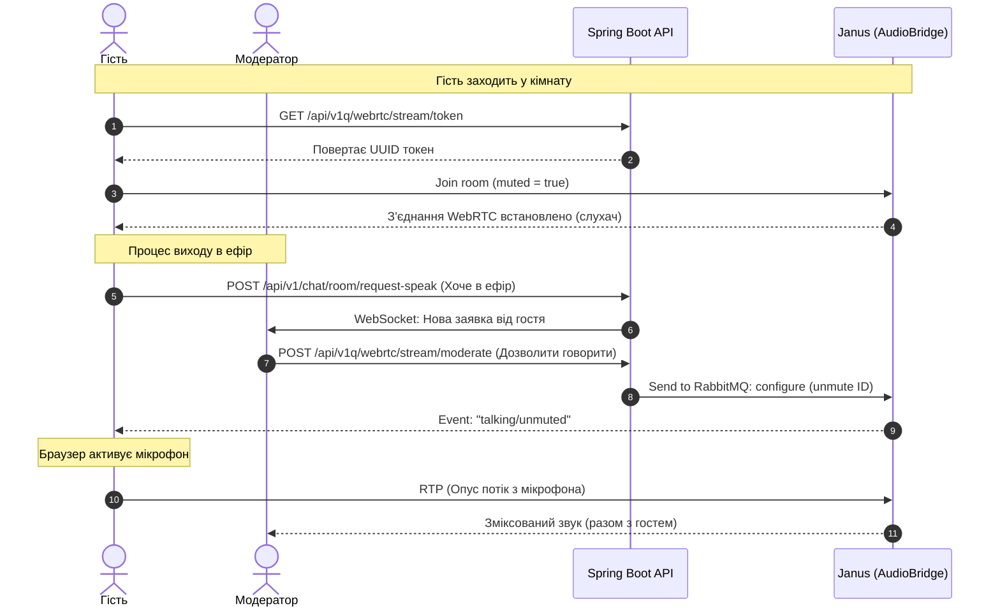

# 📡 План реалізації WebRTC + Janus (Версія 2)

Цей документ містить аналіз проблеми підключення зовнішнього аудіопотоку до кімнати Janus та детальний опис архітектури для реалізації кабінету модератора, який керує виходом гостей у прямий ефір.

---

## 🎵 Частина 1. Трансляція зовнішнього аудіопотоку (радіостанції) в Janus через FFmpeg

### 🔍 1.1 Аналіз поточної помилки в коді
У класі `RadioLiveServiceV2.java` підключення намагається використовувати команду `rtp_forward`:
```java
// Помилковий підхід у V2
streamId = janusClient.createRtpForward(janusRoomId, freePort);
```
**Чому це не працює:**
У плагіні Janus `AudioBridge` команда `rtp_forward` призначена виключно для **виведення (експорту)** зміксованого звуку з кімнати на зовнішню UDP-адресу (наприклад, для запису або ретрансляції). 
Вона **не призначена** для введення (імпорту) звуку в кімнату. Оскільки Janus не очікує пакетів на цьому порту, ваш FFmpeg надсилає дані "в нікуди".

### 💡 1.2 Рішення: Використання Plain RTP Participant
Для введення радіопотоку як повноцінного учасника кімнати, ми маємо зареєструвати його як **Plain RTP Participant**.

#### Покроковий алгоритм роботи:
1. **Налаштування кімнати:**
   Переконайтеся, що кімната створюється з `allow_rtp_participants = true` (у `JanusRabbitClientOptimized.java` це вже реалізовано).
2. **Запит на приєднання (Join) з RTP-конфігурацією:**
   Замість `rtp_forward` ми відправляємо плагіну запис про приєднання з об'єктом `"rtp"`:
   ```json
   {
     "janus": "message",
     "body": {
       "request": "join",
       "room": 802,
       "display": "Радіо Ефір",
       "rtp": {
         "ip": "127.0.0.1",       // IP адреса FFmpeg-агента
         "port": 10002,           // Локальний UDP порт FFmpeg-агента
         "payload_type": 100      // Тип корисного навантаження (Opus)
       }
     }
   }
   ```
3. **Отримання порту від Janus:**
   У відповіді на цей запит Janus повертає об'єкт `rtp` із виділеною адресою та портом **на стороні сервера Janus**, куди FFmpeg повинен слати RTP-пакети:
   ```json
   {
     "janus": "success",
     "plugindata": {
       "plugin": "janus.plugin.audiobridge",
       "data": {
         "audiobridge": "joined",
         "room": 802,
         "id": 99991111,          // Унікальний ID учасника-радіо
         "rtp": {
           "ip": "127.0.0.1",     // IP сервера Janus
           "port": 50004          // Динамічний порт Janus для прийому аудіо
         }
       }
     }
   }
   ```
4. **Запуск FFmpeg з прив'язкою до вихідного порту (localport):**
   Оскільки Janus вимагає суворої двонаправленості (джерело пакетів має точно збігатися з параметром `port`, переданим при `join`), ми запускаємо FFmpeg із вказівкою локального порту:
   ```bash
   ffmpeg -re -i http://icecast.rfa:8000/ukraine \
     -acodec libopus -b:a 128k -ar 48000 -ac 2 \
     -payload_type 100 -f rtp \
     "rtp://127.0.0.1:50004?localport=10002&pkt_size=1200"
   ```
   *Параметр `localport=10002` змушує FFmpeg відправляти пакети саме з порту `10002`, що задовольнить перевірку Janus.*

---

## 🎙️ Частина 2. Кабінет модератора та керування гостями (Go Live)

Коли модератор створює спеціальну аудіокімнату (ток-шоу або дискусійну панель), звичайні користувачі повинні заходити туди **без звуку (muted)**, але мати можливість "підняти руку", щоб модератор міг вивести їх у прямий ефір.

### 🏢 2.1 Архітектура взаємодії



### 🛠️ 2.2 Необхідні доопрацювання бекенду (Spring Boot)

#### 1. Новий REST-метод модерації у [JanusLiveControllerV2.java](file:///home/coder/rfa/src/main/java/media/toloka/rfa/media/messanger/webrtc/controller/v2/JanusLiveControllerV2.java)
```java
@PostMapping("/moderate")
public ResponseEntity<?> moderateParticipant(@RequestBody ModerateRequest request) {
    // 1. Перевірка авторизації (чи дійсно поточний користувач є модератором цієї кімнати)
    if (!messangerService.isUserModeratorOfRoom(clientService.GetCurrentUser(), request.getRoomId())) {
        return ResponseEntity.status(HttpStatus.FORBIDDEN).body("Ви не є модератором цієї кімнати");
    }

    try {
        if ("unmute".equals(request.getAction())) {
            radioLiveService.unmuteParticipant(request.getRoomId(), request.getParticipantId());
        } else if ("mute".equals(request.getAction())) {
            radioLiveService.muteParticipant(request.getRoomId(), request.getParticipantId());
        } else if ("kick".equals(request.getAction())) {
            radioLiveService.kickParticipant(request.getRoomId(), request.getParticipantId());
        }
        return ResponseEntity.ok(Map.of("success", true));
    } catch (Exception e) {
        return ResponseEntity.status(500).body(e.getMessage());
    }
}
```

#### 2. Додавання методів керування в `JanusRabbitClientOptimized.java`
Ми реалізуємо адміністративний вплив на учасників кімнати через RabbitMQ.
```java
public void muteParticipant(Long roomId, Long participantId, boolean mute) {
    executeInSession((sessionId, handleId) -> {
        String transactionId = "mod-mute-" + generateShortUUID();
        Map<String, Object> request = createBaseRequest("message", transactionId);
        request.put("session_id", sessionId);
        request.put("handle_id", handleId);

        Map<String, Object> body = new HashMap<>();
        body.put("request", "configure");
        body.put("room", roomId);
        body.put("id", participantId);
        body.put("muted", mute);
        body.put("secret", apiSecret); // Для адміністрування потрібен secret

        request.put("body", body);
        Map<String, Object> response = sendAndReceive(request);
        validatePluginResponse(response);
        return null;
    });
}
```

---

## 💻 Частина 3. Інтерфейс адміністратора (UI)

Для модератора необхідно створити додаткову панель керування. Ми можемо інтегрувати її безпосередньо у тестову сторінку [qwebrtc.html](file:///home/coder/rfa/src/main/resources/templates/test/webrtc/qwebrtc.html) та розширити [ui-renderer.js](file:///home/coder/rfa/src/main/resources/static/js/webrtc/v2/ui-renderer.js).

### 🎨 3.1 Дизайн панелі керування (Mockup)
Нижче наведено приклад інтерфейсу для модератора:

```
+-----------------------------------------------------------------------+
|  📡 Кімната: "Суботній Ефір" (ID: 802)                  🔴 LIVE (12)  |
+-----------------------------------------------------------------------+
|  🔊 Стрім радіо: [ Зупинити ] (http://icecast.rfa:8000/ukraine)      |
+-----------------------------------------------------------------------+
|  👥 Учасники в кімнаті:                                               |
|                                                                       |
|  👑 Сергій Ярихін (Модератор)                       [🎙️ Активний]    |
|                                                                       |
|  👤 Іван Петренко (Гість)                           [🔇 Вимкнено]    |
|     --> Дія: [Дати мікрофон] [Вигнати]                                |
|                                                                       |
|  👤 Марія Коваленко (Гість - Говорить)              [📢 В Ефірі]     |
|     --> Дія: [Забрати мікрофон] [Вигнати]                             |
+-----------------------------------------------------------------------+
|  🙋 Заявки на вихід в ефір:                                           |
|  - Олександр Лисенко (Хоче говорити)                [ Дозволити ]     |
+-----------------------------------------------------------------------+
```

### ✍️ 3.2 Додавання методів у JS-модулі

#### Додавання методів модерації в `room-manager.js` / `ui-renderer.js`:
```javascript
const ModeratorManager = {
    async muteUser(roomId, participantId, shouldMute) {
        Logger.log(`Moderating user ${participantId}: mute=${shouldMute}`, "INFO");
        try {
            const response = await fetch(`/api/v1q/webrtc/stream/moderate`, {
                method: 'POST',
                headers: {'Content-Type': 'application/json'},
                body: JSON.stringify({
                    roomid: roomId,
                    participantId: participantId,
                    action: shouldMute ? "mute" : "unmute"
                })
            });
            if (response.ok) {
                Logger.log("✅ Команду модерації виконано успішно", "SUCCESS");
                UIRenderer.loadRooms();
            } else {
                throw new Error("Не вдалося виконати модерацію");
            }
        } catch (e) {
            Logger.log(`❌ Помилка модерації: ${e.message}`, "ERROR");
        }
    }
};
```

---

## 🎭 Частина 4. Архітектура "Сцени" (Stage Room / Green Room)

Ваша ідея з переведенням користувачів в окрему аудіокімнату (сцену) є **надзвичайно професійною та архітектурно правильною**. У радіомовленні та подкастингу цей патерн називається **"Stage Room"** (або "Green Room").

### 🌟 4.1 Оцінка підходу (Плюси та Переваги)

1. **Повна ізоляція шуму:** Гості, які готуються вийти в ефір, можуть розмовляти з модератором або перевіряти звук у приватній кімнаті сцени, і це не буде заважати основному ефіру, доки модератор не активує їхній мікрофон чи трансляцію.
2. **Фокусована дискусія:** У кімнаті ефіру є лише ті, кого запросив модератор (наприклад, 1-3 людини), що спрощує модерацію мікрофонів.
3. **Автоматичне мікшування:** Janus AudioBridge сам мікшує голоси модератора та активних гостей в один потік, який потім можна транслювати в загальний ефір.
4. **Проста ротація:** Переведення користувача назад у загальний чат виконується простою зміною кімнати на фронтенді (де він знову стає звичайним слухачем радіопотоку).

---

### 📡 4.2 Схема інтеграції кімнат у Janus

Для реалізації цієї схеми не потрібні додаткові сервери мікшування. Ми можемо побудувати її повністю засобами Janus AudioBridge:

```
+------------------------------------------+
|  Кімната Сцени (Stage Room ID: 900)      |
|  - Модератор (WebRTC)                    |
|  - Запрошені гості (WebRTC, mute/unmute) |
+------------------------------------------+
                    │
                    │ rtp_forward (зміксований голос сцени)
                    ▼
+------------------------------------------+
|  Кімната Ефіру (Radio Room ID: 802)      |
|  - Музичний ефір (FFmpeg RTP, Part 1)    |
|  - Голос сцени (RTP forward, Part 2)     |
|                                          |
|  👥 Слухачі (WebRTC - тільки Recv)        |
+------------------------------------------+
```

#### Крок 1. Кімната Ефіру (наприклад, ID: 802)
Це публічна кімната, де знаходяться всі відвідувачі сайту.
* Усі звичайні користувачі підключаються до неї у режимі **Recv-Only** (тільки слухають зміксований звук).
* Кімната приймає **два Plain RTP потоки**:
  1. **Потік 1 (Музика):** Транслюється через FFmpeg з Icecast (як описано у Частині 1).
  2. **Потік 2 (Голоси спікерів):** Надходить із Кімнати Сцени через внутрішній `rtp_forward`.

#### Крок 2. Кімната Сцени (наприклад, ID: 900)
Це приватна кімната для розмови модератора та гостей.
* Модератор та вибрані гості підключаються сюди через стандартний WebRTC (з двостороннім аудіо).
* Модератор керує мікрофонами гостей у межах цієї кімнати за допомогою команд `mute`/`unmute` (як описано у Частині 2).
* З цієї кімнати створюється **вихідний `rtp_forward`**, який направляє зміксований звук розмови на порт прийому **Потоку 2** у Кімнаті Ефіру (802).

---

### 🛠️ 4.3 Кроки реалізації на бекенді

1. **Метод створення сцени:**
   Коли модератор запускає шоу, бекенд створює Кімнату Сцени (наприклад, 900).
2. **Налаштування містка між кімнатами:**
   Бекенд робить запит `join` для Plain RTP у Кімнату Ефіру (802), отримує UDP порт прийому (`targetPort`).
   Після цього бекенд викликає `rtp_forward` для Кімнати Сцени (900), вказуючи як ціль `127.0.0.1` та `targetPort`.
   *Таким чином, все, що говорить модератор та гості на сцені, миттєво потрапляє в загальний ефір.*
3. **Логіка ротації гостей (Move / Kick):**
   * Коли користувач "піднімає руку", модератор тисне кнопку "Запросити на сцену".
   * Бекенд через WebSocket (наприклад, Spring STOMP) надсилає команду клієнту: `SWITCH_ROOM: 900`.
   * Браузер гостя автоматично робить `detach` від кімнати ефіру 802 та робить `join` у кімнату сцени 900 (за замовчуванням muted).
   * Модератор робить `unmute` гостя на сцені, коли приходить його черга говорити.
   * По закінченню бекенд надсилає команду `SWITCH_ROOM: 802`, і гість повертається назад до слухачів.

---

## 🚀 Рекомендації щодо подальшого впровадження
1. **Перехід на Plain RTP Participant для трансляції:**
   - Створіть новий RPC-метод `joinRtpParticipant` на бекенді.
   - Оновіть команду запуску FFmpeg, передаючи туди порт, який повернув Janus у `joined` відповіді.
2. **Створення кастомних ролей у Месенджері:**
   - Додайте перевірку `EChatRoomType` або ролі користувача у Spring Security для виділення модераторів.
   - Інтегруйте WebSocket чергу (Stomp / RabbitMQ) для швидкого надсилання запиту "Хочу говорити" від гостя до модератора.

